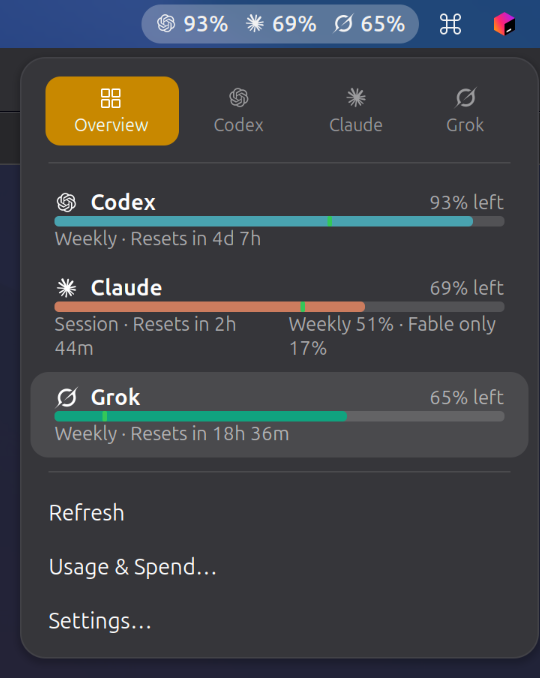
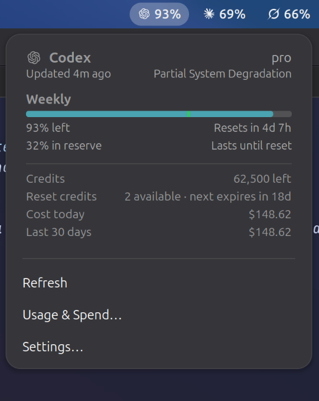

# CodexBar Panel for GNOME

A GNOME Shell extension that brings the Mac CodexBar menu to the GNOME top bar:
provider logos with remaining quota in the panel, and a menu with quota bars, pace
markers, reset times, plan, status, credits, Codex reset credits and local spending.

It is a thin frontend for the [CodexBar](https://github.com/steipete/CodexBar)
Linux desktop app (`codexbar-linux`). The desktop app owns provider selection,
polling, authentication and notifications; this extension only reads its local
snapshot (`codexbar-linux --snapshot`), so it adds no extra provider API calls.

| Merge icons (Overview) | One button per provider |
| :---: | :---: |
|  |  |

## Features

- **Merge icons** (default): one top bar button showing every provider, with a
  Mac-style switcher — *Overview* plus one tab per provider.
- **Separate icons**: turn Merge icons off for one top bar button per provider,
  each with its own menu.
- Per-window cards: Session / Weekly / model-scoped windows, brand-colored bars,
  a pace marker, remaining or used percentage, reset countdown and pace summary.
- Plan, service status, credits, extra usage, Codex reset credits (count and
  soonest expiry), and today / 30-day local spending.
- Low-quota warning colors and stale-data dimming follow the desktop app's
  display preferences.

## Requirements

- GNOME Shell 46–50.
- The CodexBar Linux desktop app, installed per its
  [Linux README](https://github.com/steipete/CodexBar/blob/main/Integrations/Linux/README.md),
  running in the background (it starts at login by default).
- Plan, status, credits, reset credits and spending need a desktop build whose
  snapshot includes those fields; older releases show quota windows only.

Choose providers and their order in **CodexBar Settings → Providers**
(`custom` for several providers). Consider turning off the desktop app's own tray
icon there to avoid a duplicate.

## Install

```sh
git clone https://github.com/KihongK/codexbar-gnome-panel
cd codexbar-gnome-panel
make install
```

On Wayland, log out and back in, then:

```sh
gnome-extensions enable codexbar-panel@kihongk.github.io
```

Settings: `gnome-extensions prefs codexbar-panel@kihongk.github.io`.

For development, `make link` symlinks the checkout instead; GNOME Shell loads
changes at the next login. `make check` validates the scripts and schema.

## License

MIT. Provider logos are adapted from CodexBar (MIT, Peter Steinberger).
This is a community project and is not affiliated with the CodexBar maintainers.
